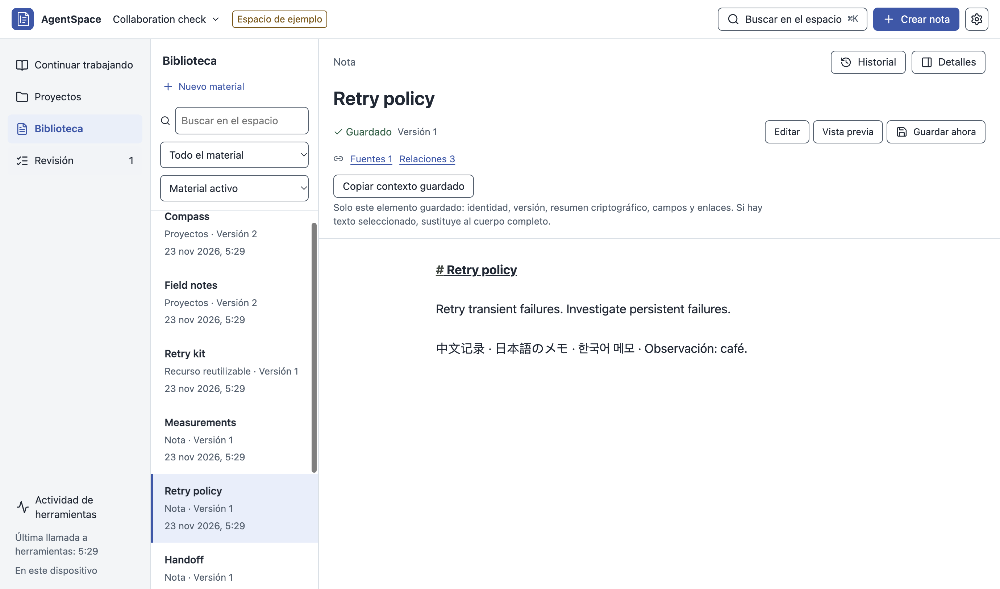
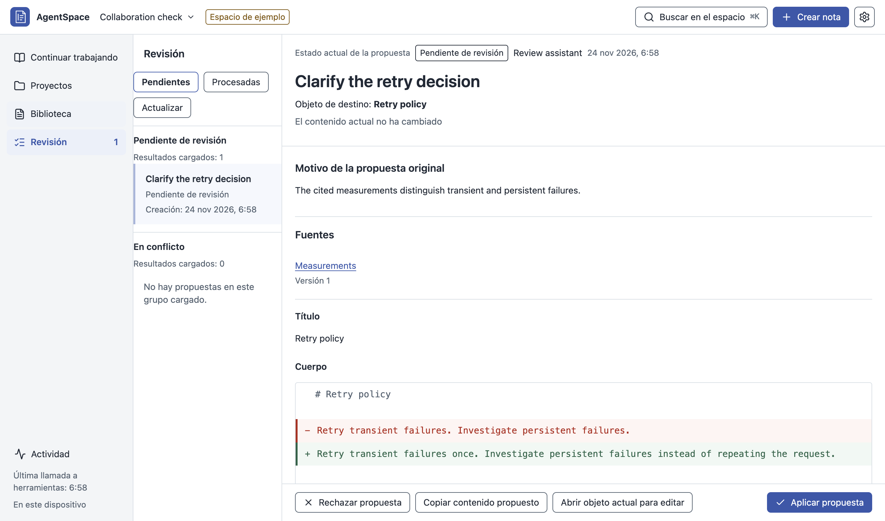

[English](README.md) · [简体中文](README.zh-CN.md) · [日本語](README.ja.md) · [한국어](README.ko.md) · Español

# Tu trabajo, más allá del chat.

Cambias de agente y vuelves a explicar el proyecto. Las notas y las decisiones quedan repartidas entre chats y carpetas. La IA avanza, pero seguir los cambios se convierte en otro trabajo.

**AgentSpace es un espacio de trabajo local que te pertenece.** Escribe y organiza tu material. Comparte contexto con distintos agentes, examina sus propuestas y decide qué cambios incorporar a tu trabajo.

[Empieza aquí](#empieza-en-local) · [Guía de uso](docs/guides/es.md) · [Arquitectura](docs/ARCHITECTURE.md)

## Conserva el contexto al cambiar de agente

Relaciona notas, documentos, registros con campos tipados y referencias reutilizables con sus proyectos. Revisa lo acumulado, lee y edita el material y prepara una explicación con referencias a versiones guardadas concretas.

Puedes usar el espacio sin una cuenta de modelos ni una clave API. Conecta un agente externo mediante MCP o CLI cuando quieras ayuda.



## Entiende los cambios. Decide qué conservar.

Lee el motivo, todas las diferencias y las versiones citadas antes de aplicar o rechazar una propuesta. Tus propias ediciones se guardan directamente. La comprobación de versiones, los borradores de recuperación y el deshacer condicionado protegen el trabajo posterior.

Consulta las versiones aceptadas y sus fuentes. El trabajo sigue siendo comprensible cuando termina la conversación que lo originó.



## Empieza en local

La aplicación funciona en **Mac con Apple Silicon y macOS 13 o posterior**.

[Descarga la aplicación para Mac](https://github.com/li508q/agent-space/releases/latest) y `SHA256SUMS`. En la carpeta de descargas, verifica el ZIP antes de descomprimirlo:

```sh
shasum -a 256 -c SHA256SUMS
```

Coloca `AgentSpace.app` en una carpeta local fija y ábrela. Incluye su entorno de ejecución; no necesitas instalar Node ni tener una cuenta de un proveedor de modelos. La descarga tiene firma ad-hoc y no está notarizada por Apple. Consulta la [instalación y seguridad de macOS](docs/DESKTOP.md#install-the-desktop).

### Ejecutar desde el código fuente

Usa la versión de Node de [`.nvmrc`](.nvmrc) y ejecuta:

```sh
git clone https://github.com/li508q/agent-space.git
cd agent-space
npm ci
npm run dev
```

Crea tu espacio o explora el espacio de ejemplo, que se guarda por separado. Ejecuta `npm run package:mac` para crear una aplicación independiente con su propio entorno de ejecución. [Compilación y plataforma](docs/DESKTOP.md).

Para conectar un agente, abre **Ajustes → Configurar acceso de agentes**, elige el material y los permisos y copia la configuración a la aplicación anfitriona del agente (host MCP). Crear notas o registros requiere un permiso adicional. [MCP y CLI](docs/AGENT_PROTOCOL.md).

## Un núcleo compartido por personas y agentes

El escritorio Electron/React, el servidor MCP y la CLI usan el mismo Core de TypeScript y la misma fuente de datos en SQLite. La identidad de los objetos, las versiones de las fuentes, los permisos y las decisiones sobre propuestas siguen los mismos contratos. La edición Markdown utiliza CodeMirror.

[Arquitectura](docs/ARCHITECTURE.md) · [Core API](docs/CORE_API.md) · [Verificación y límites](docs/TESTING.md) · [CI](https://github.com/li508q/agent-space/actions)

## Tus datos siguen siendo tuyos

Importa copias editables sin mover los originales. Conserva el historial en una copia de seguridad completa o exporta el contenido actual en un formato legible. Los archivos a los que apuntan las referencias externas se gestionan por separado.

Los espacios son archivos locales; AgentSpace no los cifra. La aplicación anfitriona de un agente conectado puede enviar material autorizado a un proveedor de modelos. Revocar el acceso bloquea futuras solicitudes, pero no recupera material ya compartido.

[Datos y confianza](docs/SECURITY.md) · [Copias y recuperación](docs/LOCAL_DATA.md)

## Construyámoslo juntos

Las contribuciones deben ayudar a encontrar contexto, entender cambios o recuperar trabajo. Consulta la [guía de contribución](CONTRIBUTING.md) para la preparación y las comprobaciones, y el [índice de documentación](docs/README.md) para los contratos del producto y su implementación.

La interfaz y las guías de uso están disponibles en **inglés, chino simplificado, japonés, coreano y español**. El contenido que escribes conserva su idioma.

[Alcance del producto](docs/PRD.md) · [Licencia MIT](LICENSE)
