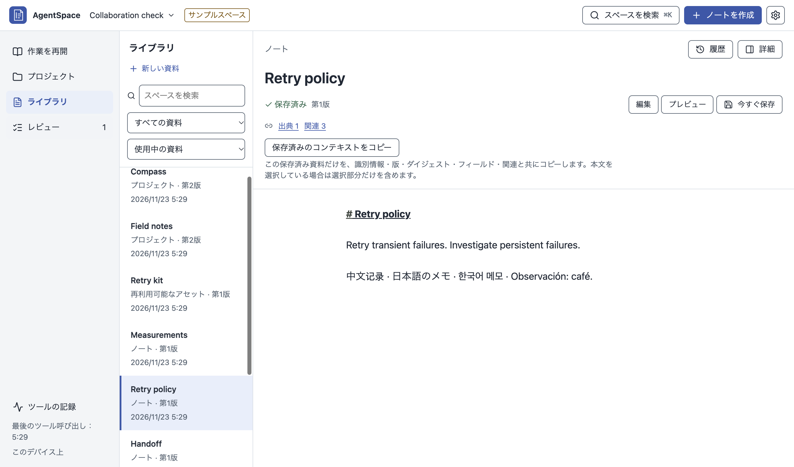
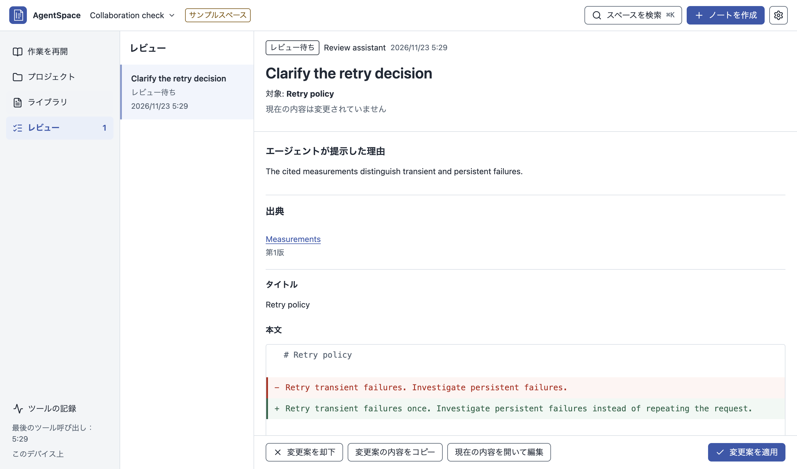

<p align="center"></p>

<p align="center"><a href="README.md">English</a> · <a href="README.zh-CN.md">简体中文</a> · 日本語 · <a href="README.ko.md">한국어</a> · <a href="README.es.md">Español</a></p>

**AI と働く。主導権は、あなたに。**

自分で書き、複数のエージェントと文脈を共有できるローカルワークスペースです。変更理由、参照した版、差分を確かめ、何を残すかを自分で決められます。



## できること

- **書く、整理する。** ノート、文書、プロジェクト、簡易レコード、再利用するアセットへの参照を一つの空間に。
- **必要な文脈を渡す。** 範囲を限定した MCP・CLI アクセスで、絞り込み、検索、関連の探索、特定版の読み取りを組み合わせる。
- **変更を理解する。** 目的、理由、差分、根拠を読み、提案を採用するか判断する。採用後の説明は、次の許可済みエージェントも参照できる。
- **自分の作業を守る。** 下書きを保持し、履歴を確認。取り消しは後から加えた編集を上書きしない。
- **資料を持ち込む、持ち出す。** フォルダーの取り込みを確認し、全履歴のバックアップや現行内容の読みやすい書き出しを作成。
- **使い慣れた言語で。** 英語、簡体字中国語、日本語、韓国語、スペイン語に対応。自分の文章は元の言語のまま。

モデルのアカウントなしで使えます。必要なときに、普段使っているエージェントを接続してください。



## ローカルで始める

初回の提供対象は macOS Apple Silicon です。ローカルでビルドしたアプリを使うか、ソースから実行できます。

```sh
git clone https://github.com/li508q/agent-space.git
cd agent-space
npm ci
npm run dev
```

[`.nvmrc`](.nvmrc) に指定した Node を使ってください。明示されたサンプル空間を開くか、自分の空間を作成します。[使い方 →](docs/guides/ja.md)

Apple Silicon Mac で `npm run package:mac` を実行すると、ランタイムを内蔵した単体アプリを作れます。[デスクトップのビルド →](docs/DESKTOP.md)

設定のエージェントアクセスで範囲と権限を選び、生成された接続設定をコピーします。新規ノート・レコードの作成には別途許可が必要です。提案はレビューして採用するまで正式な内容になりません。[MCP・CLI →](docs/AGENT_PROTOCOL.md)

## 明確な境界を持つ設計

Electron デスクトップと実際の MCP・CLI が、トランザクション対応の SQLite コアを共有します。安定したオブジェクト ID、型付きの関連、参照元の特定版、永続的な操作結果で、同じデータを扱います。React と CodeMirror が執筆画面を担い、限定したサンドボックス API がネイティブ操作を仲介します。

データはローカルにあります。外部エージェントは許可されたツールを通じて資料を取得し、モデルサービスの設定は接続先ホストが管理します。用意した参照の記録は、モデルの非公開の思考や外部作業の完了を示すものではありません。

[設計](docs/ARCHITECTURE.md) · [データと信頼の境界](docs/SECURITY.md) · [検証](docs/TESTING.md)

## コントリビュート

```sh
npm run check
npm run format:check
npm run build
```

[貢献ガイド](CONTRIBUTING.md)、[要件](docs/PRD.md)、[文書一覧](docs/README.md)をご覧ください。初版は個人のローカル作業に集中します。クラウド共同作業、汎用チャット、幅広い外部連携、アプリの実行は対象外です。

[MIT ライセンス](LICENSE)。対応環境とローカルビルドの検証範囲は使い方をご確認ください。
