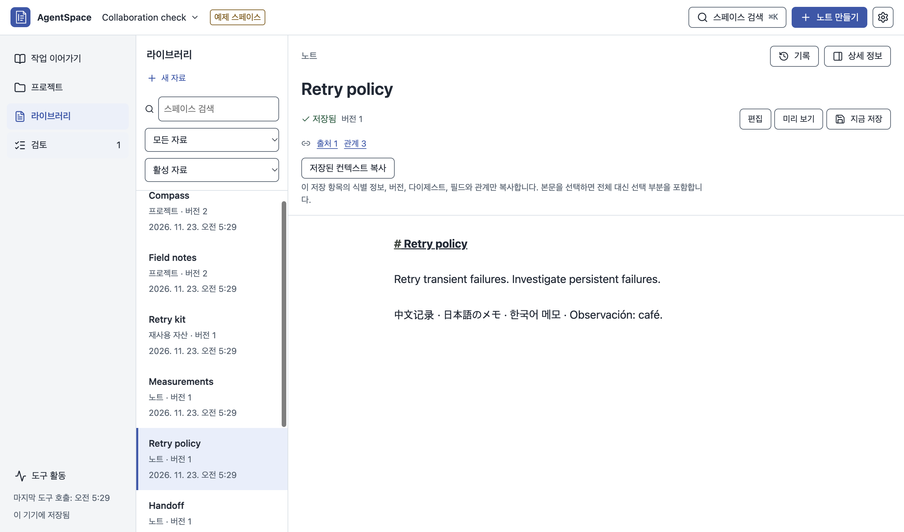

<p align="center"></p>

<p align="center"><a href="README.md">English</a> · <a href="README.zh-CN.md">简体中文</a> · <a href="README.ja.md">日本語</a> · 한국어 · <a href="README.es.md">Español</a></p>

**AI와 함께 일하고, 주도권은 내가 갖습니다.**

직접 글을 쓰고 여러 에이전트와 맥락을 공유하는 로컬 작업 공간입니다. 변경 이유와 참조 버전, 실제 차이를 확인하고 무엇을 남길지 직접 결정합니다.

**현재 상태:** 초기 로컬 버전입니다. 협업 기반은 구현되었으며 주요 사용 흐름을 다듬고 있습니다. [검증 범위와 남은 작업](docs/PRODUCT_REVIEW.md).



## 주요 기능

- **작성과 정리.** 노트, 문서, 프로젝트, 간단한 레코드와 재사용할 자산 참조를 한 공간에서 관리합니다.
- **정확한 맥락 공유.** 범위가 지정된 MCP·CLI 접근으로 필터링, 검색, 관계 탐색, 특정 버전 읽기를 조합합니다.
- **변경 내용 이해.** 제안의 목적과 이유, 차이, 근거를 검토한 뒤 적용합니다. 적용된 변경의 설명은 다음으로 권한을 받은 에이전트도 확인할 수 있습니다.
- **내 작업 보존.** 초안을 보관하고 이력을 확인합니다. 되돌리기는 이후 편집을 덮어쓰지 않습니다.
- **자료 가져오기와 내보내기.** 폴더 가져오기를 미리 확인하고, 전체 이력 백업이나 현재 내용을 읽을 수 있는 형식으로 내보냅니다.
- **익숙한 언어 사용.** 영어, 중국어 간체, 일본어, 한국어, 스페인어 UI를 지원합니다. 작성한 내용의 언어는 그대로 유지됩니다.

모델 계정 없이도 사용할 수 있습니다. 도움이 필요할 때 기존에 사용하는 에이전트를 연결하세요.


## 로컬에서 시작하기

첫 제공 대상은 macOS Apple Silicon입니다. 로컬에서 빌드한 앱을 사용하거나 소스에서 실행합니다.

```sh
git clone https://github.com/li508q/agent-space.git
cd agent-space
npm ci
npm run dev
```

[`.nvmrc`](.nvmrc)의 Node 버전을 사용하세요. 예제라고 표시된 공간을 열거나 새 로컬 공간을 만듭니다. [사용 안내 →](docs/guides/ko.md)

Apple Silicon Mac에서 `npm run package:mac`을 실행하면 런타임이 포함된 독립 앱을 빌드합니다. [데스크톱 빌드 →](docs/DESKTOP.md)

설정의 에이전트 접근에서 범위와 권한을 선택하고 생성된 구성을 복사합니다. 새 노트와 레코드를 만들려면 별도 생성 권한이 필요합니다. 제안은 사람이 검토해 적용해야 정식 내용이 됩니다. [MCP·CLI →](docs/AGENT_PROTOCOL.md)

## 명확한 경계

Electron 데스크톱과 실제 MCP·CLI가 트랜잭션 SQLite 코어를 공유합니다. 안정적인 객체 ID, 유형이 있는 관계, 정확한 출처 버전, 영구 작업 영수증으로 같은 데이터를 사용합니다. React와 CodeMirror가 작성 화면을 제공하고 제한된 샌드박스 API가 네이티브 작업을 중개합니다.

데이터는 로컬에 저장됩니다. 외부 에이전트는 허가된 도구로 요청한 자료를 받으며 모델 서비스 설정은 연결한 호스트에서 관리합니다. 준비된 참조 기록은 모델의 비공개 사고 과정이나 외부 작업의 완료를 뜻하지 않습니다.

[아키텍처](docs/ARCHITECTURE.md) · [데이터와 신뢰 경계](docs/SECURITY.md) · [검증](docs/TESTING.md)

## 기여하기

```sh
npm run check
npm run format:check
npm run build
```

[기여 안내](CONTRIBUTING.md), [요구 사항](docs/PRD.md), [문서 목록](docs/README.md)을 참고하세요. 첫 버전은 개인의 로컬 작업에 집중합니다. 클라우드 협업, 범용 채팅, 광범위한 연동과 앱 실행은 범위에 포함되지 않습니다.

[MIT 라이선스](LICENSE). 플랫폼과 로컬 빌드의 검증 범위는 사용 안내에 설명합니다.
