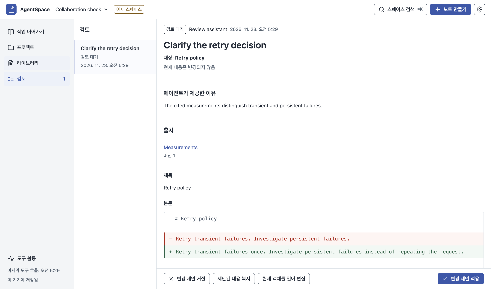

<p align="center"></p>

<p align="center"><a href="README.md">English</a> · <a href="README.zh-CN.md">简体中文</a> · <a href="README.ja.md">日本語</a> · 한국어 · <a href="README.es.md">Español</a></p>

AgentSpace는 글을 쓰고 프로젝트 자료를 쌓으며 여러 에이전트와 함께 작업하는 로컬 작업 공간입니다. 출처와 변경 제안을 확인하고 어떤 내용을 반영할지 직접 결정합니다.

모델 계정이나 API 키 없이 사용할 수 있습니다. 자료를 읽거나 수정하는 데 도움이 필요하면 외부 에이전트를 연결하세요.


## 할 수 있는 일

- **작성과 작업 재개.** Markdown을 편집하고 복구용 초안을 보관하며 최근 작업을 다시 엽니다.
- **프로젝트 자료 정리.** 노트, 문서, 유형이 지정된 레코드, 재사용 자산을 연결합니다. 프로젝트에서 본문, 이어서 작업할 참조, 축적된 자료를 확인합니다.
- **협업에 필요한 맥락 준비.** 저장된 버전의 참조와 설명을 확인한 뒤 MCP·CLI 접근 권한을 직접 만듭니다.
- **변경 검토.** 제안의 이유, 차이, 인용 출처를 읽고 적용하거나 거절합니다. 적용 당시 버전을 확인하고 이후 편집을 보호하는 실행 취소를 사용합니다.
- **데이터 보관과 이동.** 원본을 보존하며 편집 가능한 사본을 가져오고, 전체 백업이나 현재 내용의 읽기용 내보내기를 만듭니다.
- **언어 선택.** 영어, 중국어 간체, 일본어, 한국어, 스페인어를 지원합니다. 직접 작성한 내용은 원래 언어를 유지합니다.



## 로컬에서 실행하기

현재 데스크톱 대상 환경은 **macOS Apple Silicon**입니다. 소스에서 실행하려면 다음 명령을 사용하세요.

```sh
git clone https://github.com/li508q/agent-space.git
cd agent-space
npm ci
npm run dev
```

[`.nvmrc`](.nvmrc)에 지정된 Node 버전을 사용하세요. 새 스페이스를 만들거나 기존 스페이스를 열고, 별도로 저장되는 예제 스페이스를 사용해 볼 수 있습니다. [사용 안내 →](docs/guides/ko.md)

Apple Silicon Mac에서 `npm run package:mac`을 실행하면 런타임이 포함된 독립 앱을 빌드합니다. 빌드, 서명, 플랫폼 정보는 [데스크톱 설정](docs/DESKTOP.md)을 참고하세요.

**설정 → 에이전트 접근 설정**에서 대상과 권한을 선택하고 생성된 구성을 MCP 호스트에 복사합니다. 새 노트나 레코드를 만들려면 별도 권한이 필요합니다. [MCP·CLI →](docs/AGENT_PROTOCOL.md)

## 데이터와 접근 권한

스페이스는 직접 관리하는 로컬 파일입니다. AgentSpace 자체는 데이터를 암호화하지 않으므로 운영체제의 기능으로 자료와 백업을 보호하세요. 외부 자산의 참조 대상 파일은 별도로 관리합니다.

연결된 에이전트는 허용된 자료를 받을 수 있으며 호스트 설정에 따라 모델 제공자에게 전송할 수 있습니다. 로컬 저장이 이러한 공유를 막지는 않습니다. 권한을 취소하면 이후 도구 요청은 차단되지만 이미 제공한 내용은 회수할 수 없습니다. 맥락 준비나 복사가 모델의 이해 또는 작업 완료를 뜻하지는 않습니다.

[데이터와 신뢰 경계](docs/SECURITY.md) · [백업과 복구](docs/LOCAL_DATA.md)

## 개발과 기여

개발 절차와 확인 방법은 [기여 안내](CONTRIBUTING.md), 공통 코어 설계는 [아키텍처](docs/ARCHITECTURE.md), 자동 확인 결과는 [CI](https://github.com/li508q/agent-space/actions)를 참고하세요.

[문서 목록](docs/README.md) · [제품 범위](docs/PRD.md) · [검증과 제한](docs/TESTING.md) · [MIT 라이선스](LICENSE)
