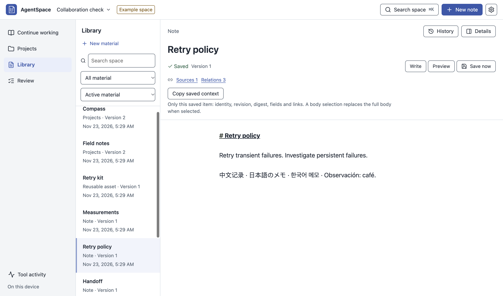
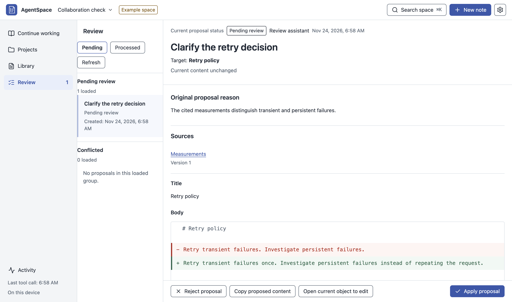

English · [简体中文](README.zh-CN.md) · [日本語](README.ja.md) · [한국어](README.ko.md) · [Español](README.es.md)

# Your work, beyond the chat.

Switch agents, and you’re explaining the project again. Notes and decisions get scattered across chats and folders. AI moves the work forward, but keeping track becomes a job of its own.

**AgentSpace is a local workspace you own.** Write and organize your material yourself. Share context with different agents, inspect their proposed changes and decide what becomes part of your work.

[Get started](#start-locally) · [User guide](docs/guides/en.md) · [Architecture](docs/ARCHITECTURE.md)

## Keep context when agents change

Connect notes, documents, typed records and reusable references to the projects they support. See what’s accumulated, read and edit the material, and prepare a brief with exact saved-version references.

Use the space without a model account or API key. Connect an external agent through MCP or CLI when you want help.



## See what changes. Decide what stays.

Read a proposal’s reason, full diff and cited source versions before accepting or rejecting it. Your own edits save directly. Version checks, recoverable drafts and conditional undo protect later work.

Inspect accepted versions and their sources. The work remains understandable beyond the conversation that produced it.



## Start locally

The desktop runs on **macOS Apple Silicon**. Use the Node version in [`.nvmrc`](.nvmrc), then:

```sh
git clone https://github.com/li508q/agent-space.git
cd agent-space
npm ci
npm run dev
```

Create your space or explore the separate example space. To build a standalone app with its own runtime, run `npm run package:mac`. [Build and platform details](docs/DESKTOP.md).

To connect an agent, open **Settings → Set up agent access**, choose material and capabilities, and copy the configuration into your MCP host. Creating new notes or records needs a separate permission. [MCP and CLI](docs/AGENT_PROTOCOL.md).

## One core for people and agents

The Electron/React desktop, MCP server and CLI use the same TypeScript Core and SQLite authority. Object identity, source versions, access rules and proposal decisions follow the same contracts. Markdown editing uses CodeMirror.

[Architecture](docs/ARCHITECTURE.md) · [Core API](docs/CORE_API.md) · [Verification and limits](docs/TESTING.md) · [CI](https://github.com/li508q/agent-space/actions)

## Your data stays yours

Import editable copies without moving the originals. Keep history in a full backup or export current content in a readable format. Files behind external references remain separately managed.

Spaces are local files; AgentSpace does not encrypt them. A connected agent’s host may send authorized material to a model provider. Revocation stops future requests; it cannot recall material already shared.

[Data and trust boundaries](docs/SECURITY.md) · [Backup and recovery](docs/LOCAL_DATA.md)

## Build with us

Contributions should help people find context, understand changes or recover their work. See [contributing](CONTRIBUTING.md) for setup and checks, and the [documentation index](docs/README.md) for product and engineering contracts.

The interface and user guides support **English, Simplified Chinese, Japanese, Korean and Spanish**. Authored content keeps its original language.

[Product scope](docs/PRD.md) · [MIT license](LICENSE)
