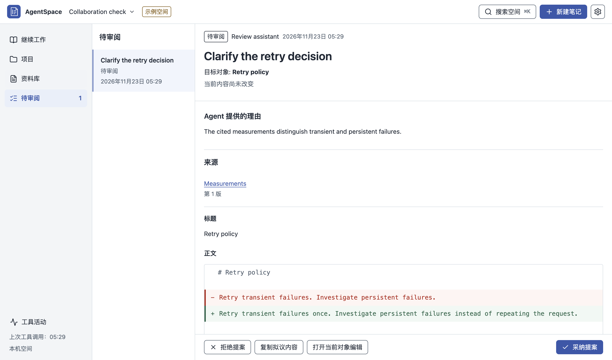

[English](README.md) · 简体中文 · [日本語](README.ja.md) · [한국어](README.ko.md) · [Español](README.es.md)

# 工作，不该止于对话。

换个 Agent，又得重讲项目背景。笔记散在文件夹里，判断留在聊天里。AI 已经改了一轮，你还没看清发生了什么。

**AgentSpace 是一个你自己拥有的本地工作空间。** 你可以直接写作、整理资料，也可以与不同 Agent 共用上下文。看清提案和依据，由自己决定哪些修改进入正式内容。

[开始使用](#开始使用) · [使用指南](docs/guides/zh-CN.md) · [架构](docs/ARCHITECTURE.md)

## 换 Agent，保留工作上下文

让笔记、文档、结构化记录和可复用的资产引用连接到项目。看清积累了什么，直接阅读和编辑资料，再为 Agent 准备带有固定版本引用的任务说明。

无需模型账号或 API key，也能独立使用。需要协助时，通过 MCP 或 CLI 连接外部 Agent。


## 看清修改，再做决定

阅读提案理由、完整差异和引用的来源版本，再采纳或拒绝。自己的编辑直接保存；版本检查、恢复草稿和条件撤销保护后续工作。

随时回看采纳时的版本及其来源，让一项工作的来龙去脉在对话结束后仍然清楚。



## 开始使用

桌面版适用于 **搭载 Apple Silicon、运行 macOS 13 或更新版本的 Mac**。

[下载 Mac 应用](https://github.com/li508q/agent-space/releases/latest)和 `SHA256SUMS`。在下载目录中先校验 ZIP，再解压：

```sh
shasum -a 256 -c SHA256SUMS
```

将 `AgentSpace.app` 放到准备长期使用的本地文件夹后打开。应用内置运行时，无需另装 Node 或拥有模型账号。下载包采用 ad-hoc 签名，未经 Apple 公证。参见[安装与 macOS 安全提示](docs/DESKTOP.md#install-the-desktop)。

### 从源码运行

使用 [`.nvmrc`](.nvmrc) 指定的 Node 版本，然后执行：

```sh
git clone https://github.com/li508q/agent-space.git
cd agent-space
npm ci
npm run dev
```

创建自己的空间，或先体验独立的示例空间。运行 `npm run package:mac` 可构建内置运行时的独立应用。[构建与平台说明](docs/DESKTOP.md)。

连接 Agent 时，打开**设置 → 设置 Agent 接入**，选择资料和权限，在所用 Agent 工具的 MCP 设置中添加配置。新建笔记或记录需要单独启用权限。[MCP 与 CLI](docs/AGENT_PROTOCOL.md)。

## 人与 Agent，共用一套内核

Electron／React 桌面端、MCP 服务和 CLI 共用 TypeScript Core 与 SQLite 数据底座。对象身份、来源版本、访问权限和提案决定遵循同一份合同。Markdown 编辑使用 CodeMirror。

[架构](docs/ARCHITECTURE.md) · [Core API](docs/CORE_API.md) · [验证与限制](docs/TESTING.md) · [CI](https://github.com/li508q/agent-space/actions)

## 数据在你手中

导入可编辑副本，保留原件。用完整备份保留历史，或把当前内容导出为可阅读的文件。外部引用指向的文件仍由你另行管理。

空间保存在本地，AgentSpace 不自行加密。运行所连接 Agent 的工具可能将授权资料发送给模型服务商。撤销授权会阻止后续请求，无法收回已经分享的内容。

[数据与信任边界](docs/SECURITY.md) · [备份与恢复](docs/LOCAL_DATA.md)

## 一起完善 AgentSpace

每一项贡献，都应帮助人找到上下文、理解变化或恢复工作。开发准备和检查见[贡献指南](CONTRIBUTING.md)，产品与工程合同见[文档索引](docs/README.md)。

界面与使用指南支持**英文、简体中文、日文、韩文和西班牙文**。自己写的内容保留原语言。

[产品范围](docs/PRD.md) · [MIT 许可证](LICENSE)
