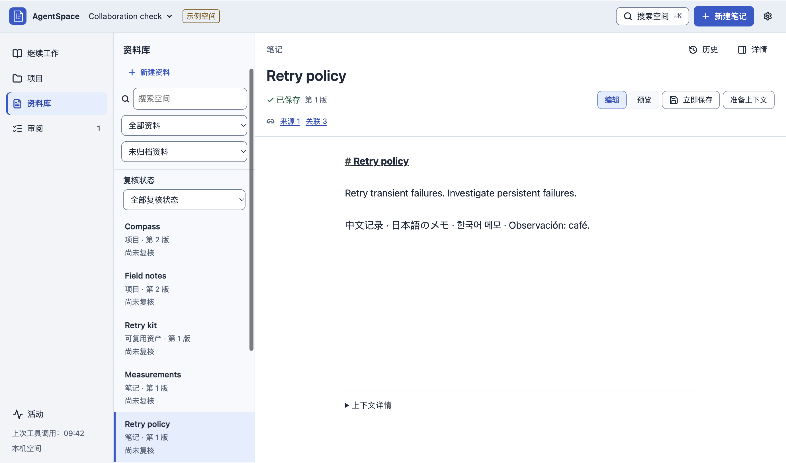

<p align="center"></p>

<p align="center"><a href="README.md">English</a> · 简体中文 · <a href="README.ja.md">日本語</a> · <a href="README.ko.md">한국어</a> · <a href="README.es.md">Español</a></p>

AgentSpace 是一个本地工作空间，用来写作、积累项目资料，并与不同 Agent 协作。你可以阅读来源、检查提案，由自己决定哪些修改进入正式内容。

无需模型账号或 API key 即可使用。需要协助阅读或修改资料时，再连接外部 Agent。



## 可以做什么

- **写作与接续。** 编辑 Markdown，保留恢复草稿，回到最近的工作。
- **积累项目资料。** 连接笔记、文档、结构化记录和可复用资产；打开项目即可查看正文、接续引用和关联资料。
- **准备协作起点。** 检查任务说明与固定版本引用，再明确创建 MCP 或 CLI 访问授权。
- **审阅修改。** 阅读提案理由、差异和引用来源，再采纳或拒绝；查看采纳时的版本，使用保护后续编辑的条件撤销。
- **保留与带走数据。** 导入可编辑副本并保留原件，创建完整备份或当前内容的可阅读导出。
- **选择界面语言。** 支持英文、简体中文、日文、韩文和西班牙文，自己写的内容保留原语言。


## 从本地开始

当前桌面版面向 **macOS Apple Silicon**。从源码运行：

```sh
git clone https://github.com/li508q/agent-space.git
cd agent-space
npm ci
npm run dev
```

使用 [`.nvmrc`](.nvmrc) 指定的 Node 版本。创建自己的空间、打开已有空间，或先试用独立的示例空间。[使用指南 →](docs/guides/zh-CN.md)

在 Apple Silicon Mac 上运行 `npm run package:mac` 可构建内置运行时的独立应用。构建、签名与平台说明见[桌面设置](docs/DESKTOP.md)。

连接 Agent 时，打开**设置 → 设置 Agent 接入**，选择对象和权限，把生成的配置复制到自己的 MCP 宿主。新建笔记或记录需要单独启用权限。[MCP 与 CLI →](docs/AGENT_PROTOCOL.md)

## 数据与授权

空间保存在你掌握的本地文件中。AgentSpace 不自行加密数据，请用操作系统保护本地资料和备份。外部资产引用连接到由你另行管理的文件。

连接的 Agent 可以取得授权范围内的资料，其宿主可能按自身设置把资料发送给模型服务商。本地保存不阻止这种分享。撤销授权会阻止后续工具请求，无法收回已经提供的内容。上下文已准备或已复制，也不代表模型已理解或任务已完成。

[数据与信任边界](docs/SECURITY.md) · [备份与恢复](docs/LOCAL_DATA.md)

## 开发与贡献

开发流程和检查见[贡献指南](CONTRIBUTING.md)，共享内核设计见[架构](docs/ARCHITECTURE.md)，自动检查结果见 [CI](https://github.com/li508q/agent-space/actions)。

[文档索引](docs/README.md) · [产品范围](docs/PRD.md) · [验证与限制](docs/TESTING.md) · [MIT 许可证](LICENSE)
