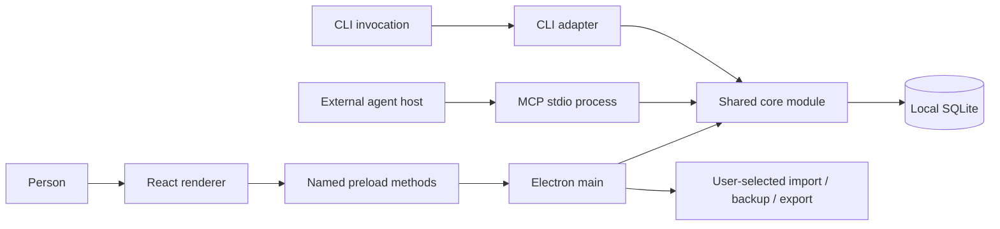

# Architecture and decisions

Status: the shared Core, real MCP/CLI and native collaboration loop have passed coordinator checks. Local import/recovery services are implemented against persistent format 2; their native UI acceptance and relocated packaging are separate gates. Product choices trace to SC-01–SC-09 / AS-01–AS-15 in [PRD.md](PRD.md). See [CORE_API.md](CORE_API.md), [LOCAL_DATA.md](LOCAL_DATA.md) and [TESTING.md](TESTING.md).

## Main route

Use a modular TypeScript core with SQLite authority, a restricted Electron desktop, and independent MCP/CLI adapters. A configured agent can read and propose while the desktop is closed. Closing an adapter ends its connection, not a committed proposal. There is no model service, general chat client, or background agent orchestrator.

Each adapter has its own core instance and connection to the same local database. Agent reads use a short write transaction to persist their prepared-result observation consistently; human view polling remains read-only. No model or transport wait holds that transaction. SQLite serializes short write transactions; there is no claim of a unique live core process. Code dependencies point inward: contracts → core → adapters → interface. The core imports neither Electron nor a model SDK. Renderer code cannot import the database driver, filesystem, process APIs, or MCP server.

## Decision records

| ADR                      | Recommended decision and reason                                                                                                                                                                                             | Alternative and change trigger                                                                                                                                                                                                                                                           |
| ------------------------ | --------------------------------------------------------------------------------------------------------------------------------------------------------------------------------------------------------------------------- | ---------------------------------------------------------------------------------------------------------------------------------------------------------------------------------------------------------------------------------------------------------------------------------------- |
| 01 Runtime and shell     | Electron 45.4.1, React 19, strict TypeScript, npm lockfile. Use `node:sqlite` through a small driver boundary. The tested Electron and system Node both provide the required API without an Electron-specific SQLite addon. | Tauri/Rust adds a second language/toolchain without a present requirement. `better-sqlite3` remains an option if the built-in API becomes incompatible or blocks a necessary feature; validate ABI rebuild and packaging first.                                                          |
| 02 Body authority        | Keep small Markdown, typed values, explicit relations, immutable revisions, proposals and receipts inside one SQLite transaction. Preserve source text; the preview is a view.                                              | Immutable body files plus database heads add publication, materialization, garbage collection and backup coordination. Revisit for large managed binary assets or measured database cost, not for hypothetical scale.                                                                    |
| 03 Core and agent bridge | Common module, separate desktop and stdio/CLI processes, one database. Agents remain usable without the UI. No daemon, service discovery or custom private socket protocol.                                                 | A single broker centralizes connections and migration, but adds startup, credentials, shutdown and crash ownership. Revisit if measured contention, long-lived work, or lifecycle requirements justify it. This choice changes the earlier research's single-coordinator recommendation. |
| 04 Editing               | CodeMirror 6 source editing with safe Markdown preview; autosave plus explicit save; separate recovery drafts. Rendering never rewrites source.                                                                             | A textarea is a probe, not the final comfortable editor. Rich text would require a document authority/round-trip decision; do not silently convert arbitrary Markdown. Editor integration and IME behavior still need native tests.                                                      |
| 05 Search and pagination | Transactional FTS5 trigram on a normalized projection, with literal fallback for short queries. Bound current-state pages to query/scope digests and a change sequence; return `CURSOR_STALE` after an authority change.    | Historical snapshots are possible using retained revisions but add query complexity. Add them only if restart-on-change proves disruptive. No semantic retrieval or completeness guarantee is implied.                                                                                   |
| 06 Agent SDK             | Official split MCP server/client packages 2.4.0, local stdio, strict schemas. New and legacy protocol openings worked in the probe.                                                                                         | The old `@modelcontextprotocol/sdk` v1 line is not the chosen server dependency. HTTP adds authentication/origin/lifecycle work and is outside the first release. Real host compatibility remains to be checked.                                                                         |
| 07 Localization          | Shared stable error codes and external dictionaries for `en`, `zh-CN`, `ja`, `ko`, `es`; persistent locale; `Intl` formatting. Keep authored text and stable IDs unchanged.                                                 | Runtime translation of user content would create new content and provenance requirements. It is outside this release.                                                                                                                                                                    |

The pinned implementation uses React 19, CodeMirror 6, safe Markdown rendering and esbuild for the desktop/adapter/renderer entries. A dev server is not a product dependency. TypeScript 5.9.3 is pinned within the installed lint parser's supported range. `node:sqlite` is experimental in Node 22; isolate the API behind the driver, use the tested runtime pins, and rerun compatibility checks on updates. The [Electron release record](https://releases.electronjs.org/release/v45.4.1) identifies its bundled Node version. The [SDK's v2 documentation](https://ts.sdk.modelcontextprotocol.io/v2/) identifies the split stable line.

## Data and authority

A space directory contains `space.sqlite` and SQLite-managed WAL/SHM sidecars. An internal `spaceId` survives moves and restore; `instanceId` distinguishes a restored copy. Paths are locators, never object identity. Use local disk; concurrent use over network filesystems is unsupported. SQLite's [WAL documentation](https://sqlite.org/wal.html) describes the same-host limitation and writer serialization.

| Logical storage          | Authority and invariants                                                                                                                                                                                                                                                                                                                                                                                                                                                                               |
| ------------------------ | ------------------------------------------------------------------------------------------------------------------------------------------------------------------------------------------------------------------------------------------------------------------------------------------------------------------------------------------------------------------------------------------------------------------------------------------------------------------------------------------------------ |
| Space metadata           | Format/core-contract version, space/instance IDs, title, example flag, monotonic authority sequence                                                                                                                                                                                                                                                                                                                                                                                                    |
| Objects and revisions    | UUID object ID; immutable kind; monotonic per-object revision; complete content and policy snapshot; parent, digest, actor and change ID. Current heads point to retained revisions.                                                                                                                                                                                                                                                                                                                   |
| Content                  | Title (including empty), exact Markdown source, typed properties and explicit relations. An empty title uses a localized display placeholder without storing a translated title. One object save changes these atomically. Maximum serialized object payload: 1 MiB. No silent truncation on write.                                                                                                                                                                                                    |
| Typed fields             | Stable ASCII property keys with separate user-authored Unicode labels, explicit text/finite-number/boolean/date/select types, null rules and select options. Labels/options remain content across locale changes. Record ID is the object ID. Each serialized field is at most 32 KiB so one entry can fit the maximum agent read budget. An agent updating an existing object may change allowed values, not redefine labels, fields/options or their type. No formulas or spreadsheet compatibility. |
| Relations                | Stable edge ID and typed predicate. `belongs_to` and `related` use identity/current references; project rename/status changes therefore display the current project. `source` requires a pinned revision. `uses` targets an asset and explicitly chooses current or pinned; `continues_from` also declares its mode. Validate actual target kinds in the transaction. Several memberships reference the same object, not copies.                                                                       |
| Origin and human policy  | Imported-copy origin/digest or external-reference locator; protected title/body/relations/property paths. Origin, protection, access grants and knowledge-review metadata are human-owned.                                                                                                                                                                                                                                                                                                             |
| Knowledge review         | Review records pin the reviewed object revision. Saving/accepting is not knowledge certification. A later revision does not inherit a claim that it was reviewed.                                                                                                                                                                                                                                                                                                                                      |
| Proposals                | Immutable ID, create/update action, proposed content or existing-target/base patch, purpose/reason, fixed sources, author grant, payload hash and optional superseded ID. A pending new-object ID is reserved but has no current object/revision. Status and its version are separate from payload; seen/unseen is separate again.                                                                                                                                                                     |
| Receipts and changes     | Stable namespace + operation key + canonical request digest; durable result and change ID. Accepted writes, proposal outcomes and policy/grant changes advance authority sequence. First release retains receipts and revisions without automatic GC.                                                                                                                                                                                                                                                  |
| Drafts and tool activity | Recovery buffers carry editor session, generation and base revision. Tool deliveries carry configured client, requested scope, returned pinned references, budgets and gaps. Neither table certifies an accepted edit or model understanding. An independent monotonic activity ID lets read-only agent actions appear without changing content/query sequence.                                                                                                                                        |
| Search projection        | Normalized text and FTS rows rebuilt from authority. Update in the same transaction as a content head. No asynchronous index freshness claim is needed.                                                                                                                                                                                                                                                                                                                                                |

Managed imported text is an editable copy with recorded origin. Folder import uses a bounded preview and confirmed grouping through a replaceable Profile; code/repository folders are asset references. Per-item receipts support safe retry without changing originals (phase 4, SC-01/AS-02). External files, repositories and other formats remain native authority: the space records references and observed versions, not a second writable master. Arbitrary native formats are not parsed, synchronized, executed or included implicitly in backup. The first release does not materialize editable shadow Markdown files.

## Shared write contract

`src/contracts/` defines strict requests, concrete response/service types and stable errors. `src/core/` now implements the authority, authorization, proposal and guarded recovery subset described in [CORE_API.md](CORE_API.md). The remaining adapter/features still follow the rules below.

1. Adapter selects the configured space and supplies trusted principal context. Never accept an actor, namespace, space path or capability from tool input. Check byte/field/count budgets and schema; reject unknown fields.
2. Start `BEGIN IMMEDIATE`, with foreign keys, `synchronous=FULL`, extension loading disabled and a bounded busy timeout. Recheck format/core-contract version and authorization inside the transaction.
3. Look up `(spaceId, principalNamespace, operationKey)`. An equal canonical request returns its original result. A different request returns `IDEMPOTENCY_KEY_REUSED`. The operation kind is included in the digest; keys cannot be reused across commands. Authorization is checked before disclosing a receipt.
4. Check the expected object revision, current protections, target kinds, typed values and source visibility. Reject malformed Unicode rather than changing source text during encoding. Store the revision/head, transactional search projection, change and receipt together; commit before reporting saved/applied.
5. A lost response is unknown to the caller. Query the original key (including its small original business-outcome discriminator, separately from current proposal status) or resend it; do not manufacture a new key. A missing receipt does not prove another request is not in flight. Storage uncertainty is reported as such, with the buffer retained.

The UI's human namespace is persistent for that installation; an agent's namespace is its durable grant ID, not a PID, connection ID or model-supplied name. Canonicalization sorts object keys recursively while preserving array order and exact string content. Retriable failures before obtaining the write lock do not invent an accepted receipt.

### Proposals and review

An **update** proposal refers to an existing retained base. A candidate with a stale base may be preserved as **conflicted**; proposing never changes the target. Protected or unauthorized changes are rejected. A **create** proposal suggests a new document or record, has full proposed content and no base revision, and is available only to a whole-space grant with propose capability. Object-scoped grants can update their existing targets only; agents cannot suggest creation of projects/assets in this release.

Reserve the requested new UUID inside the proposal transaction after the idempotency lookup. Reject collisions with existing objects or IDs reserved by any prior creation candidate (`OBJECT_ID_RESERVED`); a rejected candidate does not make its ID reusable. A candidate is visible in review/activity, not in current objects/search/project accumulation until acceptance. Acceptance rechecks the reservation belongs to that exact proposal and the object remains absent, then atomically publishes revision 1, status, change and receipt.

Acceptance is human-only and binds proposal ID, expected status version, immutable payload hash and an explicit target expectation: **absent** for create, exact **revision** for update. The proposal action must match that expectation in the core. Update base must still match the target; policy and the originating grant are checked again. A mismatch preserves the candidate and current head and produces an explicit conflict outcome. Two reviewers cannot resolve the same pending proposal twice. **Rejection** binds the candidate hash and status version but has no target-version guard and does not require the original agent grant to remain active. A person can therefore reject a stale/conflicted candidate even after later edits or grant revocation; only acceptance requires current target/policy/originating-grant checks.

Amending or rebasing creates a new proposal ID and hash (and a fresh proposed object ID for a revised creation candidate). It cannot replace payload underneath an open review. If the person wants to edit the candidate, “Use as new draft” preserves the original and creates a human draft against an explicitly chosen current revision. Saving that draft is a human edit, not acceptance of the original agent payload. Pending/applied/rejected/conflicted, unread/read, and knowledge reviewed are separate state axes.

Undo is a new human mutation. It requires the target's current revision to equal the revision produced by the change being undone and an exact expected revision. Comparing text alone is insufficient: an A→B→A history still has a later revision. Undo of an accepted creation archives the object in a new revision rather than erasing its ID or retained history. If guarded undo fails, show the retained version and offer a new draft. No field-wise merge or cross-object atomic undo is promised.

## Multi-process operation

Connections use the same driver/core contract and SQLite settings. Transactions contain database work only; model calls, UI waits and file dialogs do not hold the writer lock. The default busy timeout is five seconds. Return a localized retry action rather than looping indefinitely.

Creation runs under a write lock. Desktop creates spaces; agent adapters only open an existing supported space and never silently create or upgrade a configured path. Every transaction rechecks format/core version. First-public format 2 refuses the unreleased development format 1 and unknown/newer formats with `SCHEMA_UNSUPPORTED`; no migration or upgrade-copy product line exists. An already-open incompatible client stops rather than using cached assumptions.

The desktop checks the authority sequence and an independent activity sequence/latest ID on a one-second interval and on focus. It fetches bounded authority changes and activity pages separately. Actual agent reads/tool-result records advance the activity ID even when no proposal or content edit occurs, so the activity view updates for read-only collaboration. Activity pages use bounded ID-based pagination and an explicit upper watermark; UI status/activity polling does not itself create agent activity. Read receipts, draft saves, connection heartbeats and “seen” markers do not invalidate query pages. Each response carries space/instance identity and request generation. A clean active document may refresh; a dirty or composing buffer is retained and the external saved revision is announced. Autosave still uses its old base, so it cannot overwrite the external save. Requests returning after a space/object switch are ignored for that view.

SQLite supplies coordinated database transactions, not permissions against arbitrary same-user processes, process-level single ownership, external filesystem CAS or safety on unsupported volumes. A process bypassing the core can corrupt the file. These limits are not hidden by the shared-module architecture.

## Read tools, search and pagination

| Tool                                 | Bounded result                                                                                                                                                                                                                                                                               |
| ------------------------------------ | -------------------------------------------------------------------------------------------------------------------------------------------------------------------------------------------------------------------------------------------------------------------------------------------- |
| `space_discover` / `schema_describe` | Space identity/example flag, visible types and capabilities, schema/type/predicate meanings; no whole-space body dump                                                                                                                                                                        |
| `objects_query` / `text_search`      | Allowed kind/project/typed equality/text filters, executed scope, sequence, pinned summaries, limits, cursor and truncation                                                                                                                                                                  |
| `relations_expand`                   | Explicit direction/predicates, one hop by default, maximum two hops/50 nodes/64 KiB, fixed targets and unavailable/redacted branches                                                                                                                                                         |
| `object_read`                        | Explicit section (`summary`, `body`, `properties`, `relations`) and 1–64 KiB encoded application-result budget. Current is resolved to a fixed revision; every page returns that pin/digest, actual range, returned byte count, truncation and next cursor. No implicit whole-document read. |
| `changes_list` / `operation_status`  | Scoped durable changes/receipts, explicit pagination and unknown/not-found distinction                                                                                                                                                                                                       |
| `proposal_create`                    | One-object create/update candidate and receipt; no save/accept/reject/undo/grant/file/SQL/shell capability                                                                                                                                                                                   |

A read transaction captures scope and sequence with its results. The opaque, validated cursor binds canonical query digest, scope/grant generation digest, sequence and last object ID. Any authority-sequence change causes `CURSOR_STALE`; the client discards previous pages and restarts. This is current-state pagination, **not** a historical snapshot across calls. Exact revision reads remain historical and independent of that cursor.

Search keeps original content untouched and uses NFKC + lowercase for the projection/query. Trigram phrases of at least three Unicode code points are literal, escaped and parameter-bound; shorter strings use `instr` on normalized text within authorized scope. Apply a final literal check where needed; do not expose FTS query operators from raw user input. Accent marks are retained: uppercase/decomposed accented equivalents match, while an unaccented synonym is not promised. The [FTS5 trigram documentation](https://sqlite.org/fts5.html#the_trigram_tokenizer) explains the short-string limitation. This fallback is correct for bounded local material; short-query scan cost must still be measured on realistic data.

Agent body ranges count Unicode code points (half-open start/end), never UTF-8 byte slices or JavaScript UTF-16 offsets. The core assembles a valid Unicode fragment and measures its complete JSON application result including the cursor against `maxBytes`; no surrogate/code-point is split. Properties use stable-key order and relations stable edge-ID order with entry ranges. A single oversized field fails `LIMIT_EXCEEDED` with the required minimum budget instead of silently losing content; the trusted editor can still read the full managed object.

The opaque read cursor binds instance ID, scope/grant digest, resolved pinned revision, content digest, section and next offset. Continuation ignores later head changes and reads that same retained revision; a changed/revoked grant is rechecked before every page. Query cursors invalidate on authority changes, while pinned-read continuations do not. A request cannot combine a fresh ref with a continuation cursor. Summary metadata is bounded; source origin/currentness details are part of its read contract. Trusted human editor reads are a separate API and may return the complete managed object.

A current relationship resolves its target under the same read transaction and returns a resolved pin for that observation; its declared mode remains current. A pinned evidence link always opens the cited historical revision, with currentness shown separately. Outside-scope/unavailable targets remain unresolved, without leaking titles or silently substituting a current revision.

Only authorized objects contribute counts, snippets, relation titles or results. A reference outside scope does not grant access. Phase 3 activity records prepared result references/ranges, budgets and actual tool names; it does not observe stdout emission, host receipt, model understanding or task completion. A later adapter may add a separate trusted observation port. See the explicit stages in [CORE_API.md](CORE_API.md).

## Trusted adapters

The Electron renderer runs with `sandbox: true`, `contextIsolation: true`, `nodeIntegration: false`, normal web security and denied permissions. Preload exports named business methods, never generic `invoke`, filesystem, SQL, process, arbitrary URL loading or raw `ipcRenderer`. Main validates exact top-level window/frame identity, the packaged application origin, active space/instance and each request schema. Only main opens OS dialogs and uses the resulting file selections. This follows [Electron's security checklist](https://www.electronjs.org/docs/latest/tutorial/security) and [context-isolation guidance](https://www.electronjs.org/docs/latest/tutorial/context-isolation).

Load packaged local resources with a fixed app origin and strict CSP. Markdown is data: raw HTML is disabled; scripts, remote images, file URLs and unsafe URI schemes do not execute or load. Block navigation/new windows. Only validated HTTP(S) links may open in the system browser through a narrow user-initiated method. Source files and imported instructions do not change application policy.

Desktop creates a grant with explicit read/propose capabilities and either whole-space scope or an explicit set of object IDs. New-note/record proposals require a separate enabled creation capability in addition to whole-space propose access; selecting the scope alone does not enable creation. Selecting a project can help populate an object set; new children and linked sources are not automatically granted. Grant capabilities and creatable kinds are core policy, not model-supplied fields. Store a token hash; return the token once for the user's host configuration. Adapter launch configuration binds space path, instance ID, grant ID and token. Secrets are not tool arguments or activity content. Reload grant generation/revocation on each operation; write checks happen under the transaction lock. Grant revocation remains effective while an MCP process stays open. Anyone with same-user disk access can bypass this application boundary; it is not an OS sandbox for the host.

## Drafts, backup and portability

Retain recovery drafts independently of accepted revisions, with base and editor generation. Schedule a recovery write after 250ms and normal autosave after 800ms quiet time; defer acceptance during IME composition and serialize in-flight saves. A recovery receipt is not “Saved.” On save failure, keep the buffer; on navigation/close, flush or explicitly retain the draft. If persistence itself fails, keep the window open with copy/retry/discard choices. Sudden process termination can lose keystrokes after the last recovery write; do not claim crash-proof per-keystroke durability.

Use the SQLite online backup API to a new temporary destination, validate schema, integrity, foreign keys and revision references, then finalize the backup. Never copy only an active WAL-mode main file. Backup manifest/digest and included authority sequence come from the completed copy, not a live pre-backup guess. The [Node 22 API](https://nodejs.org/download/release/v22.22.3/docs/api/sqlite.html) exposes `DatabaseSync` and `backup`; [SQLite's backup guidance](https://www.sqlite.org/backup.html) defines the mechanism. Both tested runtimes passed a live-connection backup probe.

Restore into a new directory; reject an occupied destination. Preserve object/space IDs, retained revisions, proposals, receipts, typed values, references and drafts; assign a new instance ID, disable restored agent grants and require explicit reconnection. Never overwrite the active space. External originals are excluded. Portable export is UTF-8 Markdown plus versioned JSON metadata for current accepted objects/typed values/references; stable IDs determine filenames. It is readable data interchange, not a full-history backup or an automatic live synchronization target.

## Remaining implementation checks

See [IMPLEMENTATION.md](IMPLEMENTATION.md) and [TESTING.md](TESTING.md) for actual evidence. Core/local-file tests and no-window native-coordinator checks do not establish OS chooser UI, physical IME, moved packaging, large-library performance or non-macOS support. Focused local-data UI acceptance remains with native integration; format migration is outside this first public release.

## Implemented limits

The current core format uses a 512 MiB database page ceiling, including retained history and receipts. SQLite capacity failure maps to `LIMIT_EXCEEDED`; it is not reported as a successful save. Managed payloads are limited to 1 MiB and a serialized typed field to 32 KiB. Input trees are limited to depth 32 and 20,000 nodes; malformed/non-JSON/cyclic input returns a validation/limit error before serialization. UUIDs normalize to lowercase before identity and reservation checks. These are first-release resource limits, not measured large-library performance claims. No automatic revision/receipt garbage collection or format migration has been implemented.

## ADR 08: local import and restore authority

Persistent format/core contract 2 adds only `import_runs`/`import_items`. Immutable manifests are approved intent, and per-item results/revisions/receipts share one transaction. A sidecar journal would require reconciling accepted state after each crash; the two-table extension keeps one data authority. Format 1 was an unreleased development format, so the first public release rejects it without building compatibility/upgrade machinery. A future released-format change reopens that decision.

Main owns bounded source scanning/capture and native-selected destinations. Trusted raw import/locator methods never cross preload or MCP. A restored instance/new installation needs fresh source selection and approval before continuing an import. A source-version claim deduplicates retries while protecting human changes. No watcher, source overwrite, project-specific workflow or automatic knowledge review is implied.

Backup/export use read-only source connections, including at SQLite capacity; their consistent copy supplies counts/watermarks. Readable exports include all current objects only, while backups retain history/journal/receipts/drafts. Restore changes instance/secret and disables grants without rewriting historical receipt JSON. Foreign-installation drafts have human-only discovery/read/explicit fork. Details and boundaries are in [LOCAL_DATA.md](LOCAL_DATA.md).
