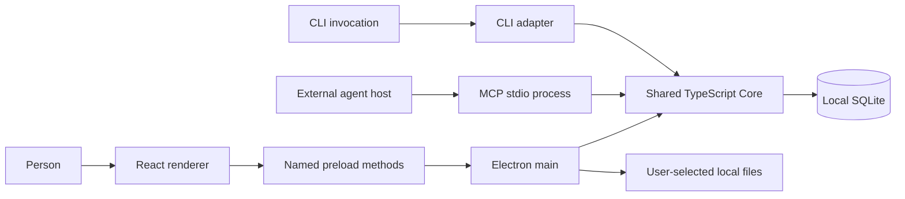

# Architecture

AgentSpace is a local, single-user workbench with a shared TypeScript Core, SQLite authority, a restricted Electron desktop, and MCP/CLI adapters. Direct writing needs no model provider. Configured agent processes can read and propose while the desktop is closed.

The detailed service contracts are in [CORE_API.md](CORE_API.md), the agent interface in [AGENT_PROTOCOL.md](AGENT_PROTOCOL.md), and portable-data rules in [LOCAL_DATA.md](LOCAL_DATA.md). [TESTING.md](TESTING.md) defines the verification scope.

## Processes and modules

Each adapter opens its own Core instance and SQLite connection. SQLite serializes short write transactions on the same local database. Database transactions contain no model calls, file dialogs or transport waits. Closing an adapter ends its connection; committed proposals remain in the space.

| Module                                           | Responsibility                                                                                             | Boundary                                                                                    |
| ------------------------------------------------ | ---------------------------------------------------------------------------------------------------------- | ------------------------------------------------------------------------------------------- |
| `src/contracts/`                                 | Strict request schemas, response types, stable errors, references and capability definitions               | Parsing establishes shape; Core still checks permission and current state.                  |
| `src/core/storage.ts`, `engine.ts`, `support.ts` | Storage settings, identity, revisions, authorization, receipts, proposals and guarded mutations            | Core owns accepted authority and imports neither Electron nor a model SDK.                  |
| `src/core/context.ts`, `search.ts`               | Scoped discovery, search, traversal, bounded reads and accepted evidence                                   | Results disclose only authorized material and explicit gaps.                                |
| `src/core/local/`                                | Read-only source capture, import journal, snapshot validation, backup, export and restore                  | Raw file/locator methods are trusted APIs; preload and agent tools do not expose them.      |
| `src/desktop/`                                   | Native dialogs, preferences, active-space binding, IPC validation and application lifecycle                | Main mediates privileged work through named business operations.                            |
| `src/adapters/`                                  | Standalone CLI and MCP stdio registration using `AgentServices`                                            | Opens existing supported spaces with configured grants; exposes no human mutation commands. |
| `src/renderer/`                                  | React views, CodeMirror editing, editor generations, review and recovery presentation, locale dictionaries | Uses preload only; has no direct filesystem, process, database or network capability.       |
| `scripts/`                                       | Builds, packaging inputs, artifact verification and documentation checks                                   | Production packaging uses an explicit output allowlist and hashes.                          |

## Identity and version sources

| Value                               | Source and meaning                                                                                                                                                           |
| ----------------------------------- | ---------------------------------------------------------------------------------------------------------------------------------------------------------------------------- |
| Application version                 | `package.json`; `scripts/build.mjs` injects it into Main, and packaging derives artifact names from it.                                                                      |
| Dependency/runtime pins             | `package.json` and `package-lock.json`; `.nvmrc` selects development Node. Electron supplies the packaged Node runtime.                                                      |
| Persistent format and Core contract | `FORMAT_VERSION` and `CORE_VERSION` in `src/core/support.ts`, enforced by `storage.ts`; both are currently `2`. Local-data constants in `src/contracts/local.ts` match them. |
| Context schema definitions          | `definitionsVersion` in `src/contracts/context.ts`, currently `2`; this is separate from the application version.                                                            |
| `spaceId` / `instanceId`            | Stored in SQLite. Moving a space preserves both. Restore preserves `spaceId` and assigns a fresh `instanceId`.                                                               |
| Object ID / revision                | Lowercase UUID with immutable object kind; monotonic per-object revision and immutable retained snapshots. Paths and titles are locators or content.                         |
| Desktop `bindingId`                 | A fresh ID for each opened workspace session, including reopening the same space. Delayed IPC callbacks must match it.                                                       |
| Human / agent namespace             | Desktop uses the persistent installation identity from preferences. Agent activity and receipts use the durable grant ID.                                                    |

A proposal records its originating grant, declared purpose, reason and pinned sources. Its grant label describes configured access; it does not authenticate a particular model. Human acceptance records a human mutation and preserves the proposal association. Declared reasoning and prepared references do not establish model understanding.

Every transaction rechecks the persistent format, Core version and identity. Unsupported formats return `SCHEMA_UNSUPPORTED`; adapters neither create nor migrate a configured space. There is no released-format migration path.

## Data authority

A space directory contains `space.sqlite` and SQLite-managed WAL/SHM sidecars. Use local disk. Concurrent access over network filesystems is unsupported. SQLite coordinates database transactions between cooperating processes; an arbitrary same-user process can bypass Core and alter the file.

| Stored data           | Invariant                                                                                                                                                                                                                                                |
| --------------------- | -------------------------------------------------------------------------------------------------------------------------------------------------------------------------------------------------------------------------------------------------------- |
| Objects and revisions | Current heads point to retained snapshots containing content, policy, origin, lifecycle, digest, actor and change ID. Saving title, exact Markdown, typed properties and relations is atomic.                                                            |
| Typed properties      | Stable ASCII field keys have independent authored labels and explicit text, finite-number, boolean, date or select types. Null, missing, empty, zero and false remain distinct. Agent updates may change allowed values, not existing field definitions. |
| Relations             | Stable edge IDs and typed predicates. `belongs_to` and `related` resolve current identity; `source` pins a revision; `uses` targets an asset and declares current/pinned mode; `continues_from` also declares its mode. Core validates target kinds.     |
| Origin and policy     | Imported-copy provenance, external-reference locators, field protection and grants are human-owned. Multiple memberships reference one object. Project archival does not cascade-delete its assets.                                                      |
| Knowledge review      | A human review pins a revision. The current-head state is derived from the highest reviewed revision: never reviewed, current reviewed or changed since review. Reading, saving, seeing or accepting a proposal does not mark knowledge reviewed.        |
| Proposals             | Immutable payload/hash and originating grant; mutable status/version; separate seen state. A new-object candidate reserves an ID without publishing a current object.                                                                                    |
| Changes and receipts  | Durable business outcomes and canonical request digests. Revisions and receipts have no automatic garbage collection.                                                                                                                                    |
| Drafts and activity   | Drafts retain editor/base/generation metadata. Prepared tool results retain references, ranges, scope and budgets. Activity is separate from accepted content.                                                                                           |
| Search                | Normalized projection and FTS rows update in the same transaction as a current head. Original source text is unchanged.                                                                                                                                  |
| Import journal        | Approved manifests and per-item outcomes live in the same database as imported revisions and receipts.                                                                                                                                                   |

Markdown preview is a view of exact source. Managed imported text is an editable copy with recorded origin. External files and repositories retain their native authority: AgentSpace stores references and observed versions, without parsing arbitrary formats, synchronizing or executing them. External originals are excluded from backup.

## Mutation and operation recovery

Core connections use foreign keys, WAL, `synchronous=FULL`, disabled extension loading and a five-second busy timeout. Mutations follow this contract:

1. The trusted adapter supplies the principal and configured space. Tool/request JSON cannot choose an actor, namespace, space path or capability. Strict schemas reject unknown fields and invalid input before mutation.
2. `BEGIN IMMEDIATE` establishes the write transaction. Recheck identity, version, authorization, protections, source visibility and expected revisions under the lock.
3. Within the same space and principal namespace, an operation key identifies a canonical request, including its command. Repeating that request returns its original result. Reusing the key for another request returns `IDEMPOTENCY_KEY_REUSED`.
4. Publish revisions, heads, search rows, changes and the receipt together. Report saved/applied only after commit. Storage/capacity failures preserve accepted authority and return a failure or uncertain result.
5. After a lost response or `OPERATION_UNKNOWN`, query the original key or resend the identical request. Retain the input and original key. A missing receipt does not establish that another request is no longer in flight.

Canonicalization sorts object keys while preserving array order and exact string content. Authorization precedes receipt disclosure. Retriable lock failures do not manufacture an accepted receipt. `operation_status` separates the original receipt's business outcome from a proposal's current status.

### Proposals, decisions and undo

Agent tools can submit a one-object update or a new document/record candidate. Updates name a retained base revision and respect current protection. A stale candidate may be retained as conflicted without changing the target. Creation requires whole-space read/propose access and separately enabled creation kinds. Object-scoped grants cannot create objects; agents cannot create projects or assets.

Creation reserves the requested UUID inside the proposal transaction. Existing or previously reserved IDs return `OBJECT_ID_RESERVED`; rejecting a candidate does not release its ID. Pending candidates appear in review/activity, while current objects, search and project material change only after acceptance.

Human acceptance binds the proposal ID, immutable payload hash, expected status version and an explicit target expectation: absent for creation, exact revision for update. Core rechecks the originating grant, scope, protection and target. A target mismatch retains the candidate and current head and records a conflict. Human rejection binds the candidate/hash/status and remains available after later target edits or grant revocation.

Amending or rebasing creates another proposal ID and payload hash. Revised creation candidates also need another object ID.

A creation proposal can be used as a human draft of the same document or record kind. Saving the draft creates a separate object. For update proposals, edit the current object directly. The original proposal remains independent.

Undo is a new human mutation. The current revision must equal the revision produced by the change being undone and the caller's expected revision. An A→B→A history still has a later revision and blocks old undo. Undo preserves current human policy/origin, grants and review records; undoing creation archives the object. External-reference relink returns `UNDO_NOT_SUPPORTED`. On a stale guard, use retained history as a new draft. There is no field-wise merge or atomic undo across objects.

## Reads, pagination and visible activity

Current-state query cursors bind the canonical filter, scope/grant generation, authority sequence and last object ID. Any authority change returns `CURSOR_STALE`; discard accumulated pages and restart. Exact revision reads have a different continuation contract: they retain the resolved pin/digest across head changes and recheck authorization on every page.

Agent reads select an explicit section and a 1–64 KiB encoded application-result budget. Body ranges count Unicode code points; properties and relations use stable entry order. Returned JSON includes the actual range, byte count, truncation and next cursor. Oversized entries return `LIMIT_EXCEEDED` with the needed minimum budget. Trusted human editor reads can return a complete managed object.

Search uses NFKC plus lowercase projection. Queries with at least three Unicode code points use escaped, parameter-bound literal trigram matching; shorter queries use a literal `instr` fallback within scope. Accents remain significant. Relation expansion is bounded to at most two hops, 50 nodes, 50 edges and 64 KiB. Unavailable/out-of-scope references do not disclose titles or silently substitute another version. Search and traversal provide no semantic-recall guarantee.

The desktop polls authority and activity separately every second and on focus. Agent reads use short write transactions to record `tool.result_prepared`; human polling remains read-only. Read receipts, drafts, heartbeats and seen markers do not invalidate content query pages. Prepared activity records Core's assembled result, without certifying stdout emission, host receipt or external task completion.

A clean active document may refresh. Dirty/composing input remains intact when another process saves, and its old base prevents overwrite. Binding, object and editor generations reject obsolete callbacks after navigation. Exact source links open the cited historical revision, with currentness shown separately. Review metadata describes the current head observed by the read, even when its content reference is historical; it is outside the pinned revision digest.

## Trusted desktop and agent adapters

Electron uses `sandbox: true`, `contextIsolation: true`, `nodeIntegration: false` and normal web security. Preload exposes named `window.agentSpace` methods. Main checks the exact WebContents, top frame, fixed `agentspace://app/index.html` document, active binding/space/instance and request schema. Main alone uses native-selected source/destination paths.

The resource manifest serves compiled renderer assets only. CSP blocks scripts from outside the app, network connections, remote images, frames and workers. Raw Markdown HTML is disabled. Navigation, new windows, webviews and permission requests are denied. Validated HTTP(S) links require a transient human action before Main asks the system browser to open them. Imported text and instructions remain data.

MCP and CLI use the same `AgentServices` and strict tool schemas. They expose bounded read/query/search/traversal, accepted evidence, operation lookup and proposal creation. They expose no save, accept, reject, undo, grant, filesystem, SQL or shell commands. Launch configuration binds an absolute space path, instance ID, grant ID and token. Tokens travel in `AGENTSPACE_TOKEN`, are stored as hashes, and stay out of tool arguments and activity content. Revocation and grant generation are rechecked on each operation, including a still-open MCP process.

## Drafts, import and portability

Editor recovery writes are scheduled after 250 ms and normal autosave after 800 ms of quiet time. Composition defers autosave; saves are serialized. A recovery receipt does not mean accepted content is saved. Failed writes keep the buffer. Navigation and close must save, durably retain a draft or leave the window open with recovery actions. Abrupt termination can lose input newer than the last successful recovery write.

Folder import uses a bounded preview and confirmed grouping. Profiles recognize ordinary text and knowledge/project/repository layouts; repository folders become references. Defaults are depth 12, 1,000 visited files and 50 MiB selected text, subject to object limits. Symlinks and excluded dependency/build/VCS directories are skipped with explicit outcomes. Import commits per item; retries reuse the recorded source version and original pin, preserving later human edits. Changed sources require a fresh preview. A restored instance/new installation needs fresh source selection and approval before resuming.

Live backup uses SQLite's online backup API, then validates the completed copy's schema, integrity, foreign keys and revision references. Manifest counts, identity, digest and sequence come from that copy. Copying only an active WAL main file is unsafe. Restore verifies the exact reviewed backup bytes, requires a new destination, preserves space/object IDs and history, changes instance/secret, and disables restored grants. Foreign-installation drafts require explicit human discovery and fork. Readable export contains current objects as UTF-8 Markdown plus versioned JSON metadata; it is not a full-history restore artifact. See [LOCAL_DATA.md](LOCAL_DATA.md) for formats and retry rules.

## Design choices and limits

| Choice                                             | Reason                                                                                                                   | Reconsider when                                                                                                               |
| -------------------------------------------------- | ------------------------------------------------------------------------------------------------------------------------ | ----------------------------------------------------------------------------------------------------------------------------- |
| Shared TypeScript Core with Electron and stdio/CLI | One authority contract serves desktop and independent agents; Electron supplies the packaged runtime and editor surface. | A different shell/runtime meets a concrete platform requirement and passes equivalent security, storage and packaging checks. |
| `node:sqlite` behind `storage.ts`                  | The pinned Node and Electron runtimes provide SQLite without a native addon rebuild.                                     | An API incompatibility or required capability justifies another driver and its packaging cost.                                |
| SQLite content/revision authority                  | Accepted content, proposals, search and receipts publish in one transaction.                                             | Managed binary assets or measured storage cost justify separate immutable files and their backup/publication coordination.    |
| Independent adapter connections                    | Agent access works without a desktop or background daemon.                                                               | Measured contention or durable background work justifies a broker's startup, credentials and crash lifecycle.                 |
| Markdown source plus safe preview                  | Editing preserves exact source.                                                                                          | Rich editing has an explicit authority and round-trip contract.                                                               |
| Current-state literal search                       | Transactional freshness and restartable pages have bounded, inspectable behavior.                                        | Measured query cost or persistent natural-task misses justify snapshots or semantic retrieval.                                |
| Local stdio MCP                                    | Grant configuration has a narrow local transport boundary.                                                               | A remote transport includes an explicit authentication, origin and lifecycle design.                                          |

Resource ceilings are 512 MiB of database pages, 1 MiB per managed object payload, 32 KiB per serialized typed field, 64 properties and 100 relations per object. Input trees are bounded to depth 32 and 20,000 nodes. Malformed Unicode, non-JSON/cyclic input and excess capacity fail explicitly. These ceilings are not large-library performance guarantees.

The desktop currently prepares context from a saved starting object, its declared links and bounded current project members, with at most 20 selected pins. It has no general workspace-wide arbitrary-selection surface. Asset Details shows the origin label and relink/lifecycle actions; it has no dedicated stored-location inspect/copy control. Automatic semantic organization, external-file synchronization, cloud sync and multi-user coordination are outside the current implementation.
